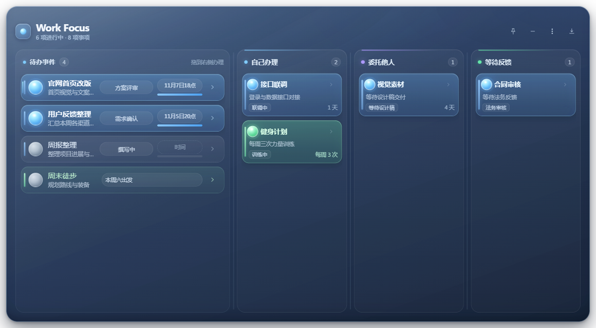

# Work Focus

一款 Windows 桌面毛玻璃小组件：左侧待办、右侧多条办理流程，把「今天要推进的事」一直摆在桌面上。



## 功能

- **待办看板**：待办按剩余时间自动排序，支持置顶、点击灯球点亮/熄灭、行尾箭头进入详情、双击文字就地编辑、右键菜单编辑/置顶/切换标签/切换倒计时模式/删除。
- **多条办理栏**：默认「自己办理 / 委托他人 / 等待反馈」三栏，栏名双击即可修改；卡片可从待办拖入办理栏（拖入即点亮），也可拖回待办（拖回即熄灭）。
- **拖拽体验**：卡片跟手、目标栏高亮、落位弹出动画、其它卡片 FLIP 让位，拖动时有幽灵卡片跟随。
- **任意调列宽**：待办区与办理栏之间、三个办理栏之间都有可拖动分隔条，宽度写入设置，重启后保持。
- **两种视图**：完整看板与紧凑小卡片，紧凑视图只显示前两项进行中的事项，可随时展开。
- **桌面集成**：无边框透明窗口、八向边缘缩放、位置记忆、临时/永久置顶、托盘图标与自绘托盘菜单、最小化到托盘、关闭时保留后台。

## 技术栈

Electron 33 · React 18 · TypeScript 5 · Vite 5

## 开发

```bash
npm install
npm run dev        # 开发模式（Vite + Electron）
npm run typecheck  # 类型检查
npm run build      # 构建渲染层与主进程
npm run start      # 构建后直接启动
npm run dist       # 生成 Windows x64 安装包（release/）
npm run dist:dir   # 只生成免安装目录（release/win-unpacked）
```

> 需要 Node.js 18+，构建目标为 Windows 10/11 x64。

## 目录结构

```
electron/    主进程：窗口管理、托盘、IPC、本地存储
shared/      共享类型、默认数据、时间与排序工具
src/         渲染层：React 组件、样式
scripts/     开发启动与 CDP 调试脚本
assets/      应用与托盘图标
docs/        截图
```

## 数据与隐私

- 所有数据只保存在本机：`%APPDATA%\work-focus\work-focus.json`
- 应用不联网、无账号体系，也不会上传任何内容
- 首次启动（没有本地数据）会生成 8 张中性示例项目卡片，方便直接体验看板和拖拽；可随时在管理页删除或修改
- 设置里包含窗口位置、尺寸、栏宽等，仅用于本机恢复布局

## 许可证

[MIT](LICENSE)
